# Atelier

Un éditeur photo façon [Photoroom](https://www.photoroom.com), **gratuit, local et sans compte**. Détoure un produit, pose-le sur un podium, une couleur ou un dégradé, ajoute une ombre, puis exporte en image, en vidéo ou par lots. Tes photos ne quittent jamais ton navigateur.

[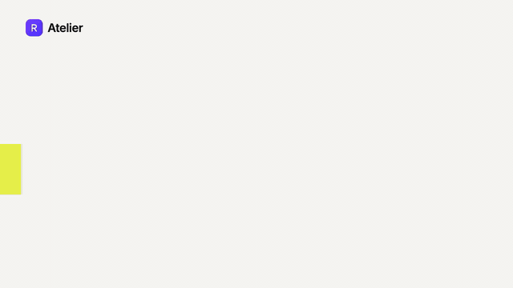](docs/demo/demo.mp4)

*Démo de 21 s ([voir en vidéo avec le son](docs/demo/demo.mp4)), réalisée avec la skill [brag](https://github.com/latent-spaces/brag).*

## Avant / après

La photo vient d'Unsplash. Tous les résultats ci-dessous sont des exports réels de l'app.

| Avant | Détourée | Podium | Studio | Dégradé |
|:---:|:---:|:---:|:---:|:---:|
| 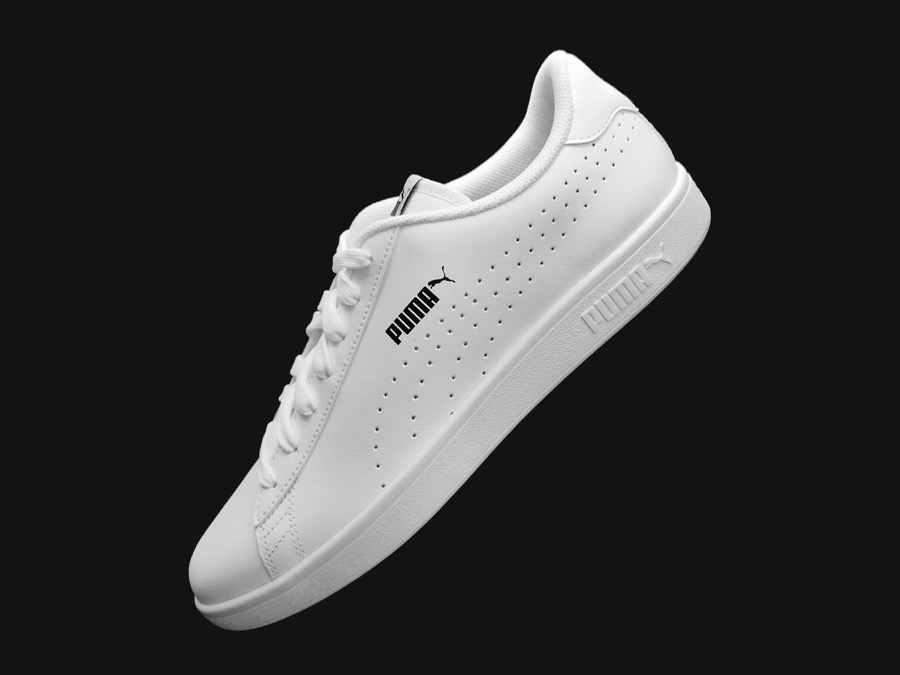 | 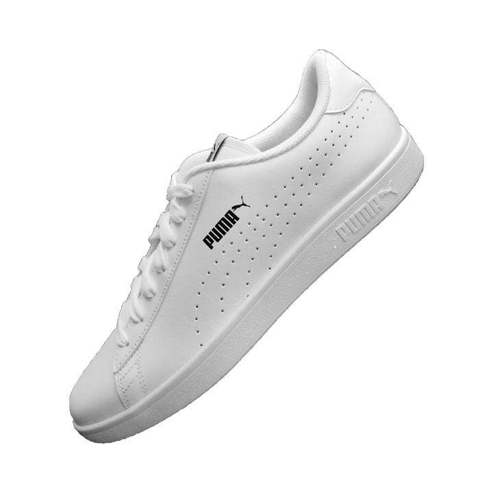 | 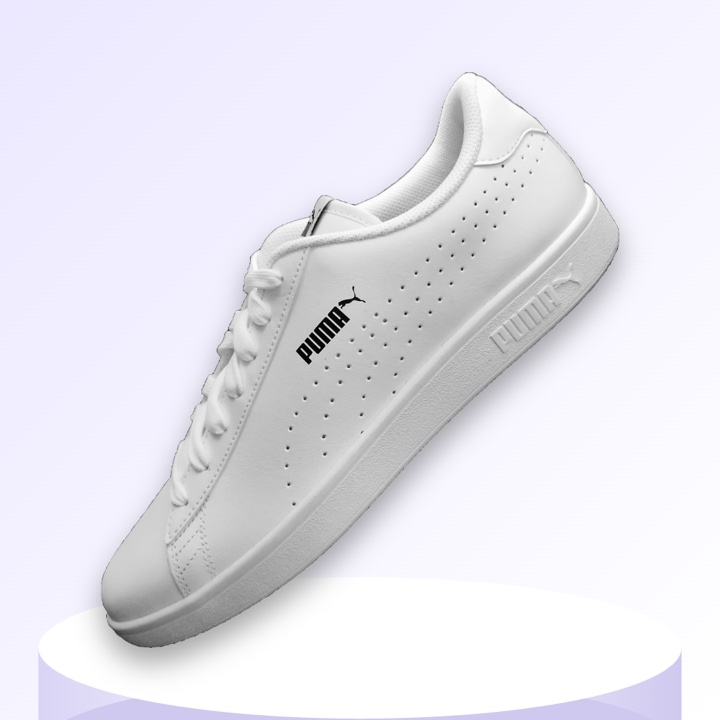 | 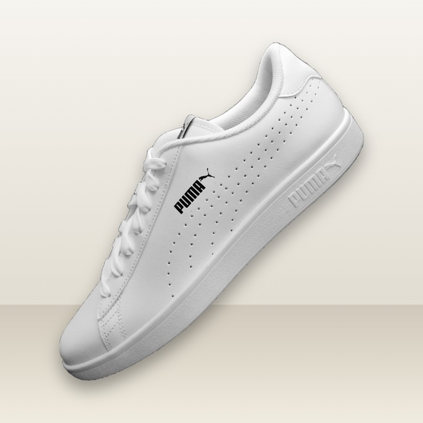 | 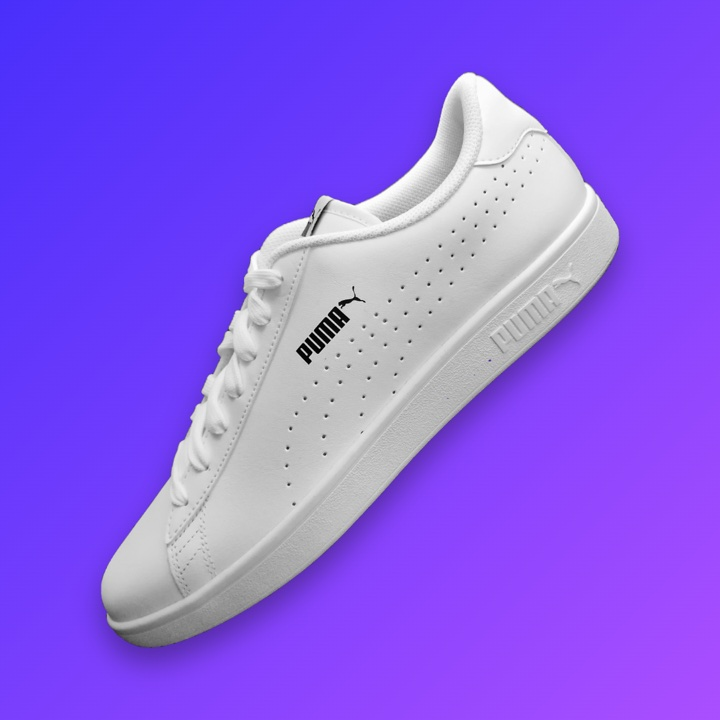 |

## Fonctionnalités

- **Détourage IA local** avec deux modèles au choix : **RMBG-1.4** (bords très fins) et **ISNet** (isole surtout le sujet principal). Un curseur règle la netteté du masque, et un outil « sujet principal » retire les objets parasites.
- **Pinceau** pour gommer ou restaurer à la main (même ce que le modèle avait effacé), avec taille, douceur du bord, annulation trait par trait (⌘Z) et rétablissement (⇧⌘Z).
- **Arrière-plans** : transparent, couleur, dégradé, flou de la photo d'origine, image, ou **scènes** dessinées par code (studio, podium, table en bois, coucher de soleil, nuit).
- **Ombres** portées ou au sol, **formats** 1:1, 4:5, 9:16, 16:9, 3:2 ou original, **retouche** (taille, rotation, luminosité, contraste, saturation, miroir).
- **Export** en PNG, JPG ou WebP, en **vidéo WebM** (zoom, flottement, balancier) et en **ZIP par lots** : le même rendu est appliqué à plusieurs photos d'un coup.
- Glisser-déposer, collage (⌘V) et déplacement du sujet à la souris. Responsive, navigable au clavier.

## Captures

| Détourage | Scène podium |
|:---:|:---:|
| 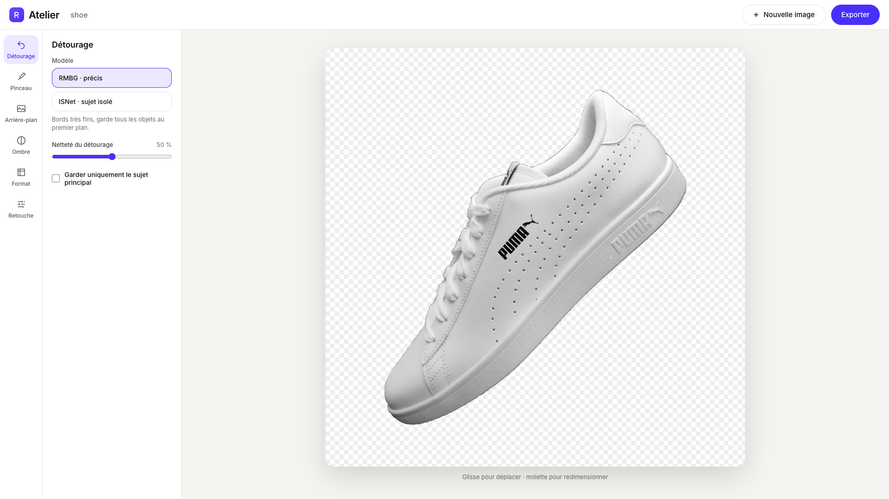 | 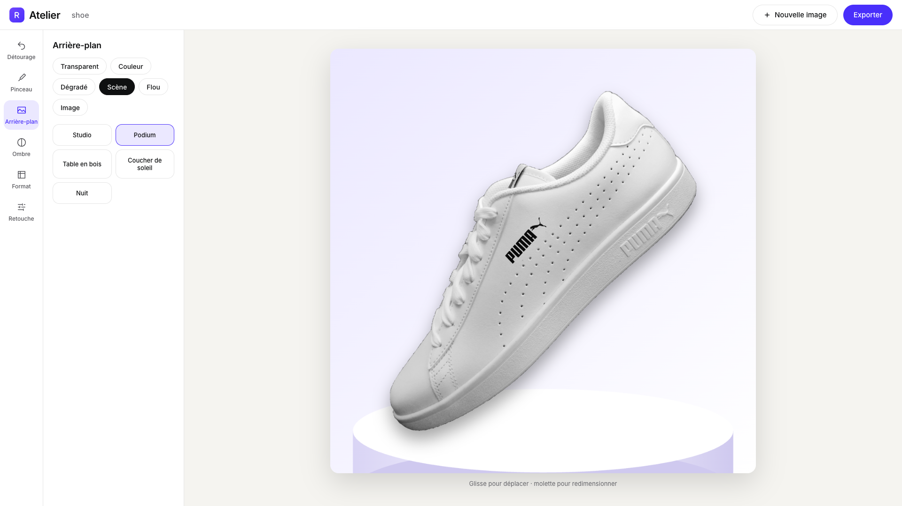 |

| Dégradé et pinceau | Export |
|:---:|:---:|
| 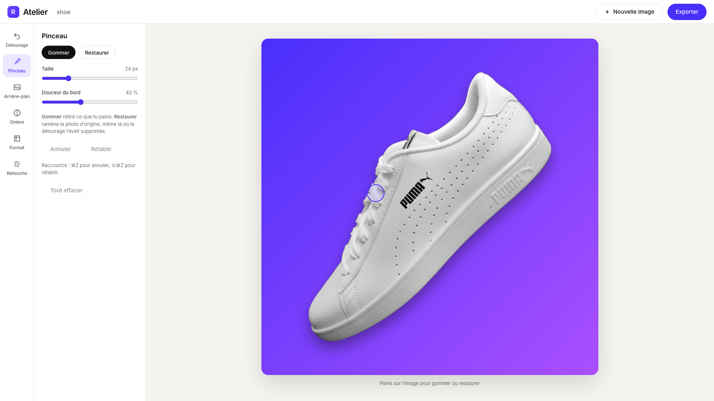 | 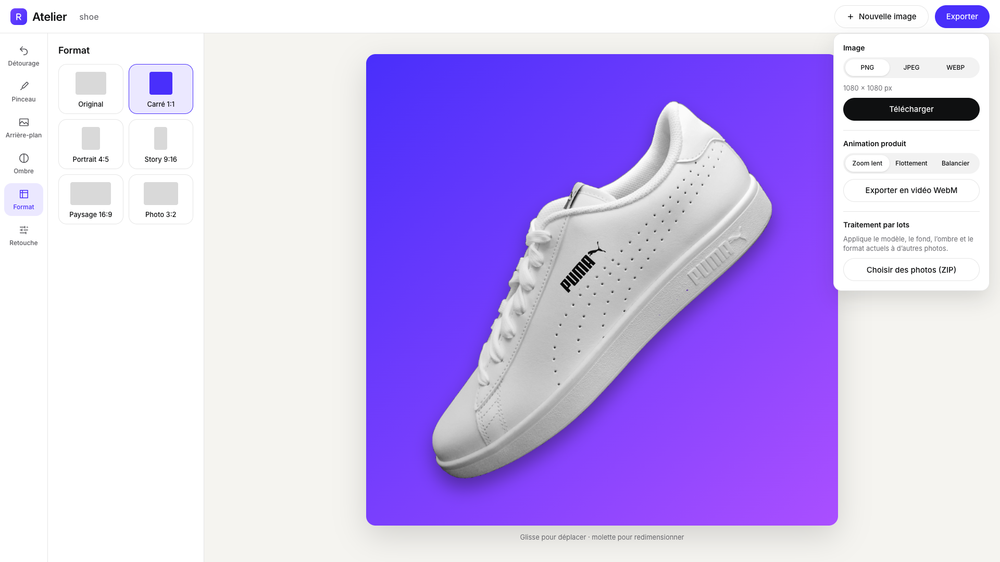 |

| Accueil | Format story | Mobile |
|:---:|:---:|:---:|
| 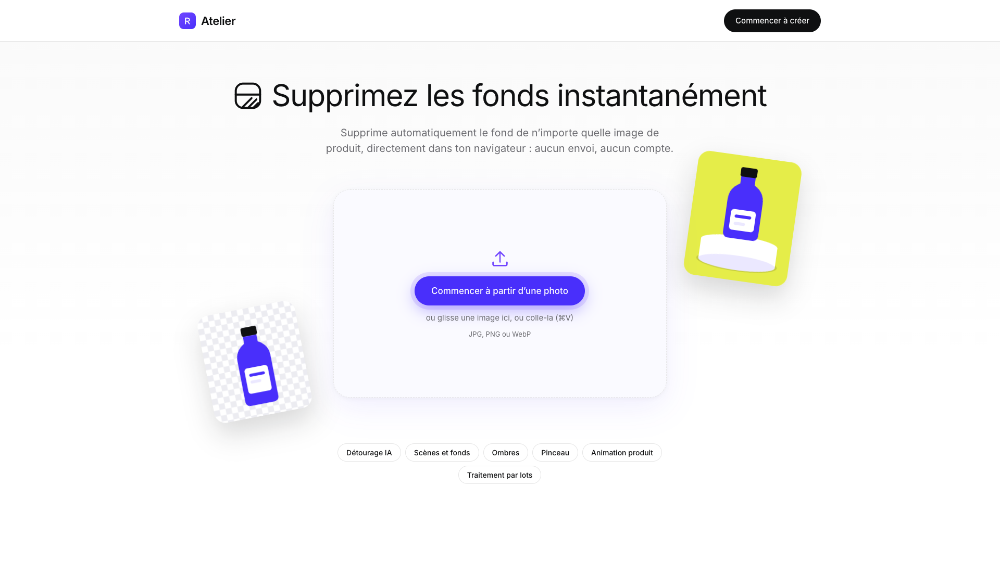 | 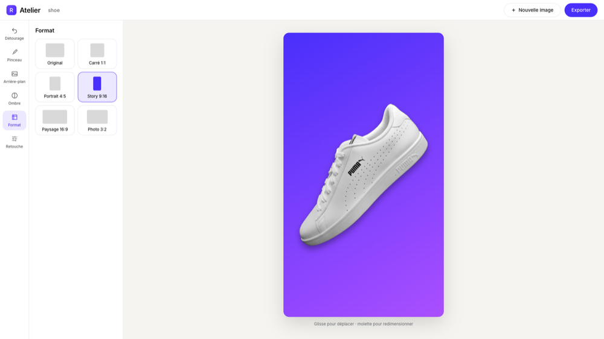 | 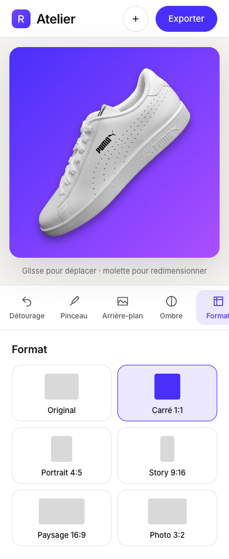 |

## Lancer le projet

```bash
npm install
npm run dev      # http://localhost:5173
npm run build    # version de production dans dist/
```

Au premier détourage, le modèle choisi est téléchargé puis gardé en cache par le navigateur. Une photo d'essai est fournie dans [`docs/sample/`](docs/sample/sneaker.jpg).

## Comment ça marche

- **Vue 3 + Vite**, sans routeur ni bibliothèque d'état : un seul état partagé dans `src/composables/useEditor.js`.
- **Rendu** : `src/lib/render.js` est une fonction pure qui dessine une scène sur un canvas. L'aperçu, l'export, la vidéo et le traitement par lots utilisent le même code.
- **Détourage** : `src/lib/segmentation/` contient les deux modèles, `refine.js` nettoie le masque et `mainSubject.js` isole le sujet principal.
- **Pinceau** : `src/lib/brush.js` garde deux calques de retouche et un historique de traits rejoués, ce qui rend l'annulation légère en mémoire.
- **Technologies** : [`@huggingface/transformers`](https://github.com/huggingface/transformers.js) (RMBG-1.4), [`@imgly/background-removal`](https://github.com/imgly/background-removal-js) (ISNet), [`fflate`](https://github.com/101arrowz/fflate) (ZIP).

## Limites connues

- Sur une photo où plusieurs sujets se touchent largement, « sujet principal » ne sait pas les séparer : utilise le modèle ISNet ou le pinceau.
- Un morceau restauré hors du cadre du sujet est coupé, et le traitement par lots n'applique pas les retouches manuelles (elles sont propres à une photo).
- L'export vidéo est en WebM (pas de MP4 directement dans le navigateur) et dure 3 secondes.
- Il n'y a pas de génération d'images par IA : ce serait trop lourd pour tourner gratuitement en local.

## Licences et crédits

- **Photo d'exemple** : [The DK Photography](https://unsplash.com/@deepain108) sur [Unsplash](https://unsplash.com/photos/white-sneaker-on-dark-background-NUoPWImmjCU), sous [licence Unsplash](https://unsplash.com/license). La marque visible sur la chaussure appartient à son propriétaire et n'est pas couverte par cette licence.
- **Modèles** : RMBG-1.4 est publié par [Bria](https://huggingface.co/briaai/RMBG-1.4) pour un usage non commercial, et `@imgly/background-removal` est sous licence AGPL-3.0. Vérifie leurs conditions avant tout usage commercial.
- **Démo** : vidéo réalisée avec [brag](https://github.com/latent-spaces/brag) (licence MIT) ; musique synthétisée par [`docs/demo/source/music.mjs`](docs/demo/source/music.mjs). Le plan et le texte de partage sont dans [`docs/demo/`](docs/demo/).
- Design inspiré de Photoroom, sans reprendre ses logos ni ses visuels.
